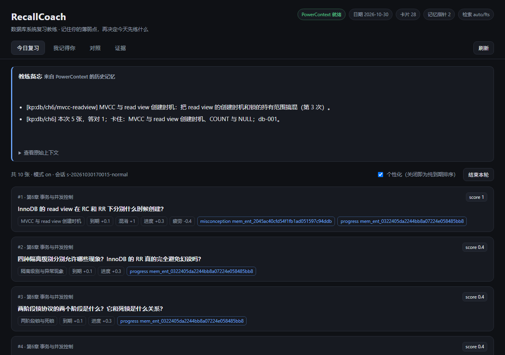

# 展示站（Qoder Sites）

纯静态两文件：`index.html` + `style.css`，无构建、无外部依赖、无 CDN。发布前只需要替换三处截图。

## 本地预览

```powershell
cd qoder\site
python -m http.server 8090
# 打开 http://127.0.0.1:8090
```

## 发布前必须做的三件事

1. **换截图**：把 `index.html` 里 `#gallery` 的三个 `.shot-placeholder` 换成真实图片：

   ```html
   <figure class="shot">
     
     <figcaption>今日队列：分数拆解与记忆命中</figcaption>
   </figure>
   ```

   建议图片宽度 1200px 左右、体积 < 300KB，放在 `site/assets/`。

2. **补仓库链接**：页脚可加一行指向代码仓库与 RUNBOOK（当前刻意留空，避免链接指向错误地址）。

3. **核对数字**：页面里的 34 个单测、8 项验证来自一次真实运行；如果你改过代码，重新跑一遍再更新。

## 发布（Qoder Sites）

1. 用**个人账号**登录 Qoder（企业版账号无法设置公开访问）。
2. 在 Qoder 中打开本项目，用 Sites 发布 `qoder/site` 目录。
3. 可见范围设为「任何人都可访问」。
4. 发布后用浏览器**无痕窗口**打开，确认未登录也能访问。
5. 以后改内容要再次点「发布」才会更新线上版本；评审结束前不要暂停或删除站点。

## 不要放上去的东西

- 任何 token、真实姓名、本机绝对路径。
- 未脱敏的使用效果截图（同学姓名、联系方式）。
- 占位图：评审点开看到"待替换"会直接减分，截图没准备好就先别发布这一节。
